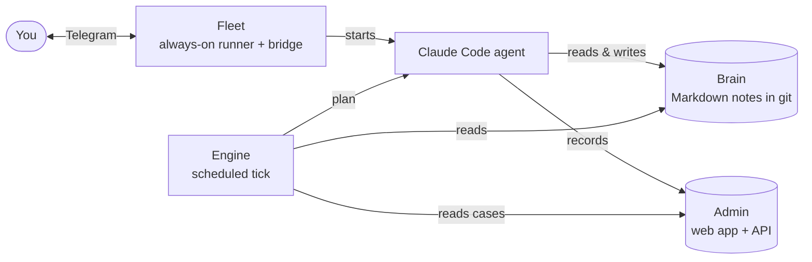

# fleet

[](https://github.com/lipi4242/fleet-leader/actions/workflows/ci.yml)

Always-on Claude Code ágensek futtatása Linux szerveren: egy paranccsal
felügyelt systemd-szolgáltatásként telepíti az ágenst, visszaindítja, ha
leáll, és összeköti a Telegrammal. ([English](README.md))

## Gyorsindítás

Azon a Linux boxon, ahol az ágens élni fog (kell: `systemd --user`, `tmux`,
a `claude` CLI, Python 3 és Node.js 18+):

```sh
git clone https://github.com/lipi4242/fleet-leader ~/fleet-leader
mkdir -p ~/.local/bin && ln -sf ~/fleet-leader/bin/fleet ~/.local/bin/fleet
fleet --version                        # kiírja: fleet <verzió>
FLEET_REGISTRY=~/fleet-leader/examples/registry fleet validate   # ellenőrzés, nem ír semmit
cd ~/az-agens-repoja                   # bármely git repó, amiben van AGENTS.md
fleet init az-agens                    # regisztrálja az ágenst; hiányzó eszköz = egy sor a javítással
fleet setup az-agens --check           # nem ír; megmondja, mi hiányzik
fleet setup az-agens                   # validate, join, preflight, install, híd, plugin, reconcile, doctor
```

Mindkét parancs idempotens, az utolsó sora az eredmény és a következő lépés. A `setup`
kilépési kódja **0** kész (doctor: healthy) · **3** fut, még nem dőlt el ·
**1** hiba — a sor megmondja az egy javító parancsot. Login: abban a shellben,
ahol a claude be van jelentkezve, `fleet auth <név>`; ha a token a gép systemd-környezetében él (`systemctl --user show-environment`), `fleet auth <név> --from-systemd`; vagy `claude auth login`. A `fleet init` hibánál a teljes hátralévő sort kiírja.

<!-- mentat:family START — identical in all four Mentat repos -->
## The Mentat family

Mentat is four small, independent pieces. Use one, or all four together.

| Piece | What it does | Repo |
|---|---|---|
| **Brain** | The agent's memory: a git repo of plain Markdown notes it reads at every start. | [mentat-ai-bootstrap](https://github.com/lipi4242/mentat-ai-bootstrap) |
| **Engine** | Decides what the agent should do next (reviews, due cases, todos) on a schedule. | [anytime-engine](https://github.com/lipi4242/anytime-engine) |
| **Fleet** | Keeps the agent running 24/7 on a server, and reachable over Telegram. | [fleet-leader](https://github.com/lipi4242/fleet-leader) |
| **Admin** | A small web app (Cloudflare) where the agent's records live and you can see them. | mentat-admin (hamarosan) |


<!-- mentat:family END -->


**Leállítás, újraindítás — csak így, ne `pkill`-lel** (az a közös tmux-szervert
és más ágenseket is leöl):

```sh
fleet stop <név>             # csak ez az ágens; a reconcile a timer egy periódusán belül visszaindítja
fleet wait-up <név>          # megvárja, megmondja mikor várható; csak ÚJ processzt (más pid) fogad el visszajövésnek
fleet stop <név> --hold 60   # 60 percig leállva marad (karbantartási zár; wait-up ilyenkor nem vár)
fleet restart <név>          # zár feloldva, újraindítás + postcheck
```

Tartós pihentetés: `status: "dormant"` a registryben. A lépések egyenként is
futtathatók (`validate`, `join`, `preflight`, `install`, `bridge install`,
`reconcile`, `doctor`); részletek: `docs/workflows/` (`new-agent`,
`zero-touch-setup`, `cutover`).

## A registry

A registry nem része ennek a repónak, a saját könyvtáradban él. A `fleet` a registry könyvtárát így keresi, ebben a sorrendben:

1. a `FLEET_REGISTRY` környezeti változó;
2. a `~/.config/fleet/registry` fájl (egyetlen sor: a könyvtár útvonala);
3. ha egyik sincs, vagy nem létező könyvtárra mutat: hibával megáll
   („nincs registry beállítva: …"). Nincs csendes alapérték.

```sh
export FLEET_REGISTRY=~/fleet-config/fleet          # egy sessionre
echo ~/fleet-config/fleet > ~/.config/fleet/registry  # tartósan, a boxon (a timerek ezt olvassák)
```

A registry szerkezete (a példa: `examples/registry/`, kitalált ágensekkel):

| fájl | mit ír le |
|---|---|
| `agents.json` | HOL és HOGYAN fut egy ágens: host, unit, session, `rc_name`, `status` (`active`/`dormant`), kadencia, híd, `claude_account` |
| `boxes.json` | a gépek (`key`, `hostname`, …) |
| `accounts.json` | külső fiókok azonosítói, titok nélkül |
| `runbooks/` | ágensenkénti runbook; az `agents.json` `runbook` mezője ehhez a könyvtárhoz relatív |
| `units/` | opcionális: kézzel írt unitok (`unit_source: file`) |

A `fleet init` ezt a minimumot maga írja (`~/.config/fleet/registry.d`).
Titok (token, kulcs) nem kerül a registrybe: a bot-token a boxon,
`~/.config/<agent>/telegram.env`-ben él (0600).

## A rétegek

| réteg | hol | mit tud |
|---|---|---|
| **Futtató** | `src/fleet/` (stdlib Python), `bin/fleet` | `init`, `validate`, `preflight`, `render`/`install`, `bridge install`/`status`, `reconcile` (timer), `postcheck`, `doctor`, `roster`, `stop`/`wait-up`/`restart`, `lock`/`unlock`/`unquarantine`, `join`/`upgrade`, `status`, `release` |
| **Híd** | `bridge/` (Node) | Telegram ↔ tmux: `bridge.mjs` (poller, inbox, health), `send.mjs` (plain text; `--html` szűrt formázás) |
| **Plugin + sablonok** | `plugin/`, `templates/` | a skillek és a SessionStart hook; unit-sablon (`--remote-control`, `--strict-mcp-config` beépítve), drop-in, `rules/fleet.md.tmpl`, systemd-timerek |

A szerkezeti szabály: a futtató **csak a registryből olvas**, és csak
stdlibet használ. A híd Node, de a futtató nem importálja — unitot ír neki.

## Felügyelet: az öt jel

| jel | forrás | ha rossz |
|---|---|---|
| **processz** | fut-e a `claude` a várt `--remote-control <név>`-vel | restart (3/óra), utána postcheck |
| **ütemezés** | `last-tick.json` / tick-marker a transzkriptben; ha a flotta ütemez (`schedule_owner: fleet`), a `last-tick.json` a `fleet-tick-<név>.timer` periódusához mérve — `proactive: false` mellett is | re-arm (csak a claude-loopnak); 12 periódus (vagy `silence_after_s`) után riasztás |
| **csatorna** | a híd `health.json`-ja + 409 a journalban | poller leölése / híd-restart (költségvetéssel) |
| **RC** (opcionális) | a transzkript RC-eseményei — csak esemény, nem állapot | jelentés; az állapotot a `/fleet:roster` (ListAgents) méri; nem mérhetően `n/a`, a kilépési kódot nem rontja |
| **auth** | `authentication_failed` assistant-rekord a transzkriptben, utána nincs valódi válasz | riasztás (restart nem gyógyítja): `claude auth login` azon a boxon |

Mindegyiknek van `unknown` értéke, és az nem `down` és nem `ok`. A `fleet
doctor` minden jelet `healthy` · `pending` · `unknown` · `unhealthy` szerint
ítél, az ágens a legrosszabb jelét kapja, és csak a teljes `healthy` OK
(kilépési kód 0). Kivétel az RC: opcionális jel, nem mérhetően `n/a` (➖),
és nem rontja az ítéletet — a bizonyított leszakadás viszont hiba. Egy
indítási ablaknál álló tmux-pane hiba, akkor is, ha a processz fut; a `--fix` sikere a javítás utáni újramérés. Egy restart
akkor „kész", ha a **postcheck** zöld: új processz-generáció, nincs
telegram-plugin poller, nincs 409, az auth él, és a restart UTÁN landolt tick
(a türelmi időn belül `pending`, utána bukás; az RC nem kötelező, mert a
visszakapcsolódás nem naplózódik). Két bukott postcheck
→ karantén, riasztás, ember oldja fel.

`dormant` = kívánt állapot: a reconcile leállítja és letiltja, ami fut. A
`systemctl disable` önmagában nem üzen a felügyeletnek.

## Mi fut a boxokon

| timer | periódus | mit csinál |
|---|---|---|
| `fleet-reconcile` | `templates/systemd/fleet-reconcile.timer` | az EGY vezérlő: a registry kívánt állapota + postcheck, OOM-védelem (-600), tick re-arm, duplikáció-riasztás |
| `fleet-reconcile-fast` | 30 mp | gyors út (`reconcile --fast`): CSAK a két egymás utáni megfigyelésben hiányzó claude-processzt indítja újra (≤~1 perc); híd, riasztás, re-arm marad a teljes körön — ezek nem gyorsíthatók (a 409 elmúlása percekbe telik, a költségvetést a hatás előtt égetné el) |
| `fleet-tick-<ágens>` | a motor ütemezése szerint | a motor tick-belépője, ha a join átvette az ütemezést |

A heartbeatet csak a motor írja; a felügyelet a transzkript korát és a
`last-tick.json`-t olvassa (a régi `agent-liveness.timer` maga is
írta a heartbeatet, ezt a `fleet install` leveszi). A sablonok a
`templates/systemd/` alatt; a checkout útvonalát a telepítés helyettesíti be.
Ha ugyanaz az ágens egy másik gépen (a registry `host`-ja szerint) EZEN a
gépen is fut, a reconcile és a doctor riaszt. A tulajdonjog a `~/.config/fleet/controller` fájlban
(`reconcile`); nélküle a reconcile csak megfigyel. A box kulcsa:
`FLEET_HOST` vagy `~/.config/fleet/host`, különben a `boxes.json` `hostname`
mezője; ismeretlen gépen nincs alapértelmezett box.

## Tesztek

```sh
PYTHONPATH=src python3 -m unittest discover -s tests -q
PYTHONPATH=src python3 -m unittest discover -s src/fleet -p 'test_*.py' -q
node --test "bridge/test/*.test.mjs"
FLEET_REGISTRY=examples/registry PYTHONPATH=src python3 -m fleet.cli validate
```

A Python-tesztek a `pytest` csomagot is importálják (a tesztek unittest és
pytest alatt is futnak), ezért az legyen telepítve. A registry-konzisztencia
tesztjei (`tests/test_registry_consistency.py`,
`tests/test_registry_runbook_egyezes.py`) alapból a példa-registryt nézik;
`FLEET_REGISTRY`-vel a saját registrydre is lefuttathatók.

## Ami szándékosan nincs itt

- A konkrét flotta adatai (registry, runbookok, ops-jegyzetek) — tartsd
  egy saját könyvtárban vagy repóban.
- A szoba-alapú ágens-közi kommunikáció (rooms, post, follow) és a korábbi
  flotta-vezérlő ágens; a natív Claude Code csatorna (`ListAgents` /
  `SendMessage`) váltotta ki. A híd 2.0-tól csak kézbesítési naplót vezet
  (`bridge/docs/delivery-log.md`).

## Licenc

Apache-2.0, lásd `LICENSE` és `NOTICE`.
