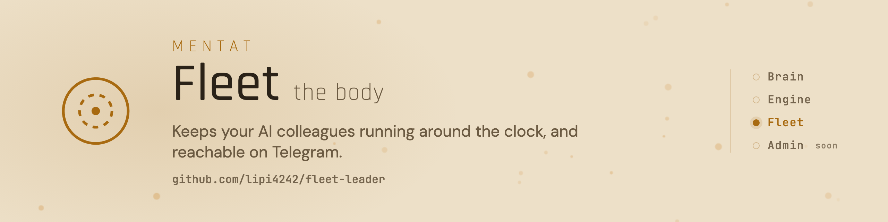

<picture>
  <source media="(prefers-color-scheme: dark)" srcset="assets/banner-dark.png">
  
</picture>

# Mentat Fleet

[](https://github.com/lipi4242/fleet-leader/tags)
[](https://github.com/lipi4242/fleet-leader/actions/workflows/ci.yml)
[](LICENSE)
[](https://docs.claude.com/en/docs/claude-code)
[](https://www.python.org/)
[](README.md)

Csak akkor kell, ha azt szeretnéd, hogy a kollégád akkor is dolgozzon, amikor a laptopod le van csukva. A flotta éjjel-nappal futtatja a Mentat-kollégáidat egy kis Linux szerveren, legyen az havi néhány euróért bérelt gép vagy egy otthoni régi számítógép, és Telegramon beszélsz velük.

- Egy paranccsal jut el egy ágens a mappájától a futásig a szerveren.
- Minden ágenst figyel, összeomlás után kb. egy perc alatt visszahozza, és csak akkor mutat zöldet, ha az ágens tényleg dolgozik.
- Telegram mindkét irányban, minden kézbesített üzenetről nyugtával.
- Több ágens egy szerveren, mindegyik külön leállítható és újraindítható.
- Ellenőrzi, hogy minden ágens védelme valóban be van-e kapcsolva, és az igened nélkül nem engedi az e-mail-címedet harmadik félhez.

## Telepítés

A legegyszerűbb: kérd meg a Mentat-kollégádat, hogy tegye fel ezt a szerveredre, ő futtatja a lépéseket. Kézzel, a Linux szerveren (kell: `systemd --user`, `tmux`, a `claude` CLI, Python 3 és Node.js 18+):

```sh
git clone --branch v0.3.1 https://github.com/lipi4242/fleet-leader ~/fleet-leader
mkdir -p ~/.local/bin && ln -sf ~/fleet-leader/bin/fleet ~/.local/bin/fleet
cd ~/az-agens-repoja && fleet init az-agens && fleet setup az-agens
```

A `fleet setup` 0-val lép ki, ha az ágens egészséges, 3-mal, ha fut, de még nem bizonyított, és 1-gyel hibánál, ilyenkor megadja az egy javító parancsot. Részletek: [a flotta útmutatója](docs/workflows/fleet-guide.hu.md).

## Képesség-napló

A legújabb bejegyzések:

- Az e-mail-címed nálad marad
- Minden ágensnél ellenőrzött védelem
- Az új ágens tisztán indul
- Biztonságosabb alapbeállítások
- Egy szerver ágensei látják, mit tud már a szomszédjuk

Kiadási jegyzetek (angolul): [CHANGELOG.md](CHANGELOG.md). Minden változás a teljes csomagban: [képesség-napló](https://github.com/lipi4242/mentat-ai-bootstrap/blob/main/CAPABILITY-LOG.hu.md).

<!-- mentat:family START (a mentat-ai-bootstrap-dev docs/readme/render.py generálja; minden Mentat-repóban azonos) -->
## A Mentat csomag

| Rész | Mit csinál |
|---|---|
| [Mentat Brain](https://github.com/lipi4242/mentat-ai-bootstrap) | Maga a kolléga: memória sima jegyzetekben, gitben, személyiség, biztonsági szabályok, eszközök. |
| [Mentat Engine](https://github.com/lipi4242/anytime-engine) | Az ütemezés: reggeli összefoglaló, határidő-emlékeztetők, és figyel minden nyitott ügyre. |
| [Mentat Fleet](https://github.com/lipi4242/fleet-leader) | Szerveren, éjjel-nappal futtatja az ágenseket, és a Telegramhoz köti őket. |
| Mentat Admin | Kis webalkalmazás az ágens nyilvántartásaihoz. Hamarosan. |
<!-- mentat:family END -->

## Tovább

[A flotta útmutatója](docs/workflows/fleet-guide.hu.md) · [Lépésenkénti útmutatók](docs/workflows/) · [Biztonság](SECURITY.md) · [Apache-2.0](LICENSE)
