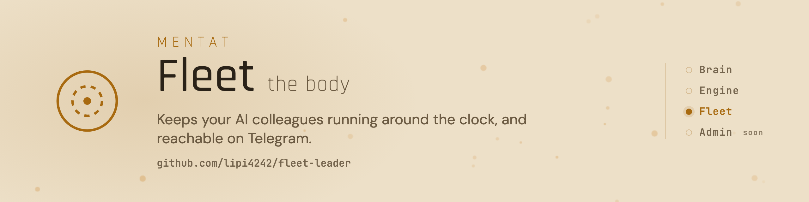

<picture>
  <source media="(prefers-color-scheme: dark)" srcset="assets/banner-dark.png">
  
</picture>

# Mentat Fleet

[](https://github.com/lipi4242/fleet-leader/tags)
[](https://github.com/lipi4242/fleet-leader/actions/workflows/ci.yml)
[](LICENSE)
[](https://docs.claude.com/en/docs/claude-code)
[](https://www.python.org/)
[](README.hu.md)

You need this only if you want your colleague to keep working while your laptop is closed. Fleet runs your Mentat colleagues day and night on a small Linux server, a rented one for a few euros a month or an old computer at home, and you talk to them on Telegram.

- One command takes an agent from its folder to running on the server.
- It watches every agent and brings it back about a minute after a crash; it shows green only when the agent is really working.
- Telegram in both directions, with a receipt for every delivered message.
- Several agents on one server, each stopped and restarted on its own.
- It checks that every agent's safety guard is really on, and keeps your e-mail address from going to a third party without your yes.

## Install

Easiest: ask your Mentat colleague to set this up on your server; it runs these steps for you. By hand, on the Linux server (needs `systemd --user`, `tmux`, the `claude` CLI, Python 3 and Node.js 18+):

```sh
git clone --branch v0.3.1 https://github.com/lipi4242/fleet-leader ~/fleet-leader
mkdir -p ~/.local/bin && ln -sf ~/fleet-leader/bin/fleet ~/.local/bin/fleet
cd ~/my-agent-repo && fleet init my-agent && fleet setup my-agent
```

`fleet setup` exits 0 when the agent is healthy, 3 when it runs but is not proven yet, and 1 on an error, with the one command that fixes it. Details: [the fleet guide](docs/workflows/fleet-guide.md).

## Feature log

Newest entries:

- Your e-mail address stays with you
- Safety guard checked on every agent
- New agents come up cleanly
- Safer defaults
- Agents on one server can see what their neighbours already do

Release notes: [CHANGELOG.md](CHANGELOG.md). Every change across the kit: [capability log](https://github.com/lipi4242/mentat-ai-bootstrap/blob/main/CAPABILITY-LOG.md).

<!-- mentat:family START (generated by docs/readme/render.py in mentat-ai-bootstrap-dev; identical in every Mentat repo) -->
## The Mentat kit

| Part | What it does |
|---|---|
| [Mentat Brain](https://github.com/lipi4242/mentat-ai-bootstrap) | The colleague itself: memory as plain notes in git, personality, safety rules, tools. |
| [Mentat Engine](https://github.com/lipi4242/anytime-engine) | The schedule: morning summary, deadline reminders, and a watch on every open case. |
| [Mentat Fleet](https://github.com/lipi4242/fleet-leader) | Runs agents around the clock on a server and connects them to Telegram. |
| Mentat Admin | A small web app for the agent's records. Coming soon. |
<!-- mentat:family END -->

## More

[Fleet guide](docs/workflows/fleet-guide.md) · [Step-by-step guides (Hungarian)](docs/workflows/) · [Security](SECURITY.md) · [Apache-2.0](LICENSE)
