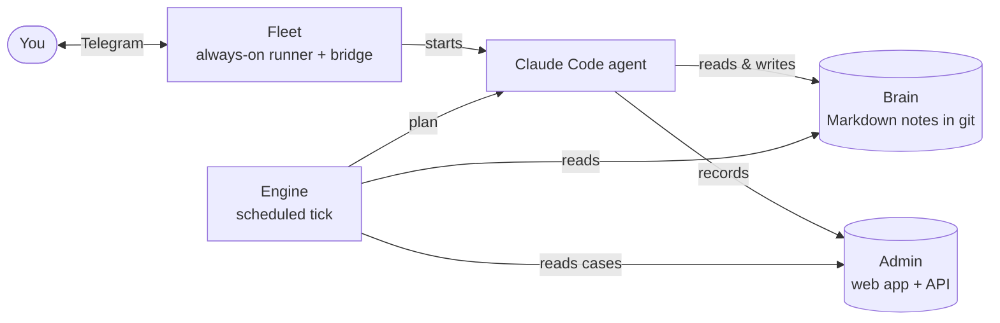

# fleet

[](https://github.com/lipi4242/fleet-leader/actions/workflows/ci.yml)

Run always-on Claude Code agents on a Linux server: one command installs an
agent as a supervised systemd service, brings it back when it dies, and
connects it to Telegram. ([Magyarul](README.hu.md))

## Quickstart

On the Linux box where the agent will live (needs `systemd --user`, `tmux`,
the `claude` CLI, Python 3 and Node.js 18+):

```sh
git clone https://github.com/lipi4242/fleet-leader ~/fleet-leader
mkdir -p ~/.local/bin && ln -sf ~/fleet-leader/bin/fleet ~/.local/bin/fleet
fleet --version                        # prints: fleet <version>
FLEET_REGISTRY=~/fleet-leader/examples/registry fleet validate   # sanity check, writes nothing
cd ~/my-agent-repo                     # any git repo with an AGENTS.md
fleet init my-agent                    # registers the agent; a missing tool = one line with the fix
fleet setup my-agent --check           # changes nothing, tells you what is missing
fleet setup my-agent                   # validate, join, preflight, install, bridge, plugin, reconcile, doctor
```

`fleet init` and `fleet setup` are idempotent; their last line is the result
and the next step. `fleet setup` exits **0** when the agent is healthy, **3**
when it runs but is not proven yet, **1** on an error (the output names the
one command that fixes it). Log in as the agent's user with `claude auth login`,
or hand over a token with `fleet auth my-agent`.

Note: the command output and the guides under `docs/` are currently in
Hungarian.

<!-- mentat:family START — identical in all four Mentat repos -->
## The Mentat family

Mentat is four small, independent pieces. Use one, or all four together.

| Piece | What it does | Repo |
|---|---|---|
| **Brain** | The agent's memory: a git repo of plain Markdown notes it reads at every start. | [mentat-ai-bootstrap](https://github.com/lipi4242/mentat-ai-bootstrap) |
| **Engine** | Decides what the agent should do next (reviews, due cases, todos) on a schedule. | [anytime-engine](https://github.com/lipi4242/anytime-engine) |
| **Fleet** | Keeps the agent running 24/7 on a server, and reachable over Telegram. | [fleet-leader](https://github.com/lipi4242/fleet-leader) |
| **Admin** | A small web app (Cloudflare) where the agent's records live and you can see them. | mentat-admin (coming soon) |


<!-- mentat:family END -->

## Stop and restart an agent

Use these instead of `pkill`, which would also kill the shared tmux server and
the other agents:

```sh
fleet stop my-agent            # this agent only; reconcile restarts it within one timer period
fleet wait-up my-agent         # waits until a NEW process (different pid) is up
fleet stop my-agent --hold 60  # stay down for 60 minutes (maintenance lock)
fleet restart my-agent         # releases the lock, restarts, runs the postcheck
```

For a long rest set `"status": "dormant"` in the registry.

## The registry

The registry says WHERE and HOW each agent runs. It is not part of this
repository: it lives in a directory you own. `fleet` finds it in this order:

1. the `FLEET_REGISTRY` environment variable;
2. the `~/.config/fleet/registry` file (one line: the directory path);
3. otherwise it stops with an error ("no registry configured"). There is no
   silent default.

| file | what it describes |
|---|---|
| `agents.json` | where and how an agent runs: host, unit, session, `rc_name`, `status` (`active`/`dormant`), cadence, bridge, `claude_account` |
| `boxes.json` | the machines |
| `accounts.json` | external account identifiers, no secrets |
| `runbooks/` | one runbook per agent |
| `units/` | optional hand-written units (`unit_source: file`) |

`examples/registry/` is a complete example with made-up agents; `fleet init`
writes the minimum for you (`~/.config/fleet/registry.d`). Secrets (tokens,
keys) never go into the registry: a bot token lives on the box in
`~/.config/<agent>/telegram.env` (mode 0600).

## Layers

| layer | where | what it does |
|---|---|---|
| **Runner** | `src/fleet/` (Python, stdlib only), `bin/fleet` | `init`, `setup`, `validate`, `preflight`, `install`, `bridge`, `reconcile` (timer), `postcheck`, `doctor`, `roster`, `stop`/`wait-up`/`restart`, `lock`/`unlock`/`unquarantine`, `join`/`upgrade`, `status`, `release` |
| **Bridge** | `bridge/` (Node.js) | Telegram to tmux: `bridge.mjs` (poller, inbox, health), `send.mjs` (plain text; `--html` for filtered formatting) |
| **Plugin and templates** | `plugin/`, `templates/` | Claude Code skills and a SessionStart hook; unit template, drop-in, `rules/fleet.md.tmpl`, systemd timers |

The runner only reads the registry and uses only the standard library. The
bridge is Node.js, but the runner never imports it: it writes a unit for it.

## Supervision: five signals

| signal | source | when it is bad |
|---|---|---|
| **process** | is `claude` running with the expected `--remote-control <name>` | restart (3 per hour), then postcheck |
| **schedule** | `last-tick.json` or the tick marker in the transcript; for fleet-scheduled agents, measured against the `fleet-tick-<name>.timer` period | re-arm (claude loop only); alert after 12 periods (or `silence_after_s`) |
| **channel** | the bridge's `health.json` and 409 errors in the journal | kill the poller or restart the bridge (with a budget) |
| **RC** (optional) | Remote Control events in the transcript, an event rather than a state | report; if it cannot be measured it is `n/a` and does not affect the exit code |
| **auth** | an `authentication_failed` record in the transcript with no real reply after it | alert (a restart does not cure it): `claude auth login` on that box |

Every signal has an `unknown` value, which is neither `down` nor `ok`.
`fleet doctor` rates each signal `healthy`, `pending`, `unknown` or
`unhealthy`; an agent gets its worst signal and only a full `healthy` exits 0.
A restart counts as done when the **postcheck** is green: a new process
generation, no telegram-plugin poller, no 409, auth alive, and a tick that
landed AFTER the restart (`pending` within the grace period, a failure after
it). Two failed postchecks put the agent in quarantine with an alert for a
human to lift.

`dormant` is a desired state: reconcile stops and disables what runs. A bare
`systemctl disable` does not tell the supervisor anything.

## What runs on the box

| timer | period | what it does |
|---|---|---|
| `fleet-reconcile` | `templates/systemd/fleet-reconcile.timer` | the ONE controller: desired state from the registry plus postcheck, OOM protection (-600), tick re-arm, duplicate alerts |
| `fleet-reconcile-fast` | 30 s | fast path (`reconcile --fast`): restarts only a claude process missing in two consecutive observations (about 1 minute); bridge, alerts and re-arm stay on the full round |
| `fleet-tick-<agent>` | the engine's schedule | the engine's tick entry point, when `join` took over scheduling |

Only the engine writes the heartbeat; supervision reads the transcript age and
`last-tick.json`. Templates live under `templates/systemd/`; `fleet install`
substitutes the checkout path. If the same agent (by the registry's `host`)
also runs on THIS machine, reconcile and doctor raise an alert. Ownership is
the `~/.config/fleet/controller` file (`reconcile`); without it reconcile only
observes. The box key is `FLEET_HOST` or `~/.config/fleet/host`, otherwise the
`hostname` in `boxes.json`; an unknown machine has no default box.

## Tests

```sh
PYTHONPATH=src python3 -m unittest discover -s tests -q
PYTHONPATH=src python3 -m unittest discover -s src/fleet -p 'test_*.py' -q
node --test "bridge/test/*.test.mjs"
FLEET_REGISTRY=examples/registry PYTHONPATH=src python3 -m fleet.cli validate
```

The Python tests import `pytest` as well (they run under both unittest and
pytest), so install it. The registry consistency tests
(`tests/test_registry_consistency.py`, `tests/test_registry_runbook_egyezes.py`)
check the example registry by default; point `FLEET_REGISTRY` at your own to
run them against it.

## Not included on purpose

- Your fleet's own data (registry, runbooks, ops notes): keep it in a
  directory or repository you own.
- Room-based agent-to-agent messaging and a dedicated fleet-controller agent;
  the native Claude Code channel (`ListAgents` / `SendMessage`) replaced them.
  From version 2.0 the bridge only keeps a delivery log
  (`bridge/docs/delivery-log.md`).

## License

Apache-2.0, see `LICENSE` and `NOTICE`.
